# Nordisk designforsking 2000–2026 — datavitskapleg oversikt

Dette er ein **eksplorativ metadatastudie**, ikkje ei ferdig metaanalyse av fulltekstforsking.
Alle tal gjeld den delvis utvida, rangsorterte OpenAlex-databasen.

## Utval og datakvalitet

| Målepunkt | Målt |
|:--|--:|
| Unike OpenAlex-kandidatar | 7 300 |
| Automatiske tittelinkluderingar | 3 729 |
| Med samandrag i lokal database | 2 922 |
| Søkjesider henta utan feil | 96 |
| Søkjesider avbrotne av rategrense | 1 |
| Interne siteringskantar | 3 159 |
| Referansetilvisingar til alle OpenAlex-arbeid | 126 356 |
| Par med minst tre felles referansar etter filtrering | 16 916 |
| Sterkare bibliografisk kopla par | 1 022 |

## 1. Kva søka faktisk fann

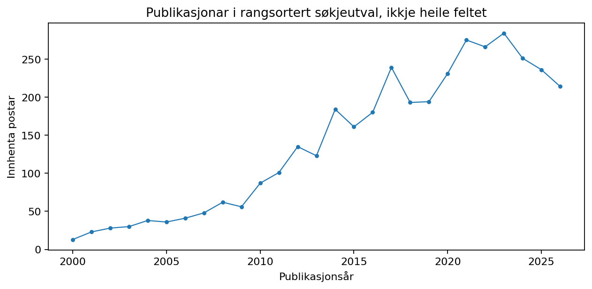

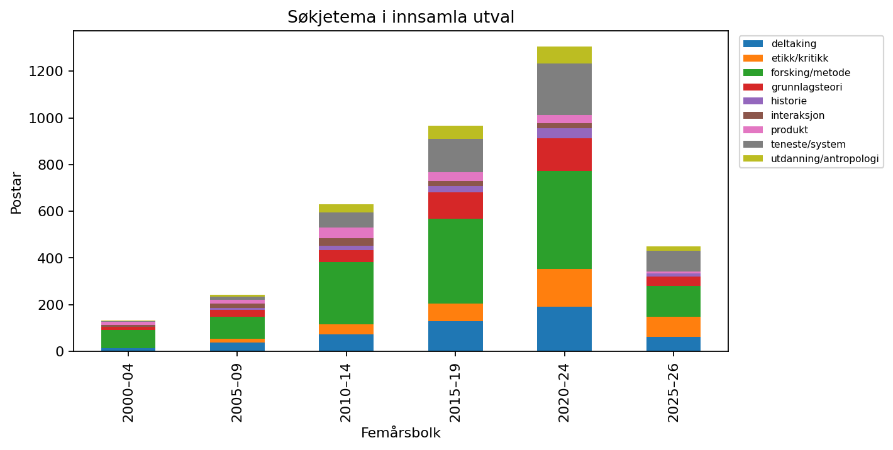

Tidsseriane er **ikkje** vekstestimater for forskingsfeltet; OpenAlex-søka er
avgrensa til dei mest rangerte treffa innan kvar frase og ikkje fullstendige årspopulasjonar.

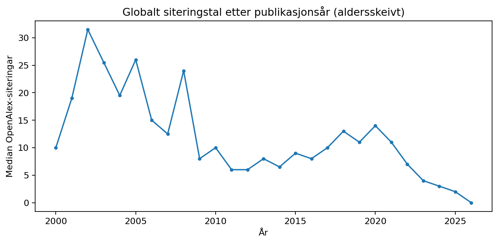

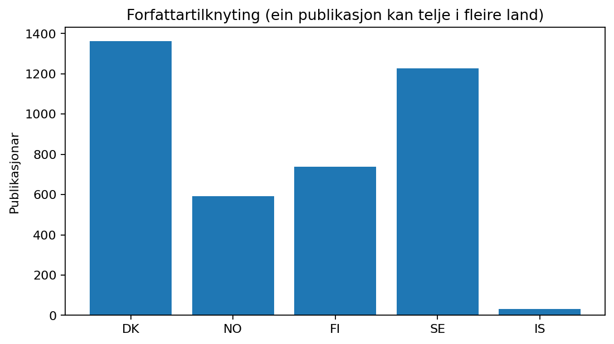

## 2. Nettverk og kumulativitet

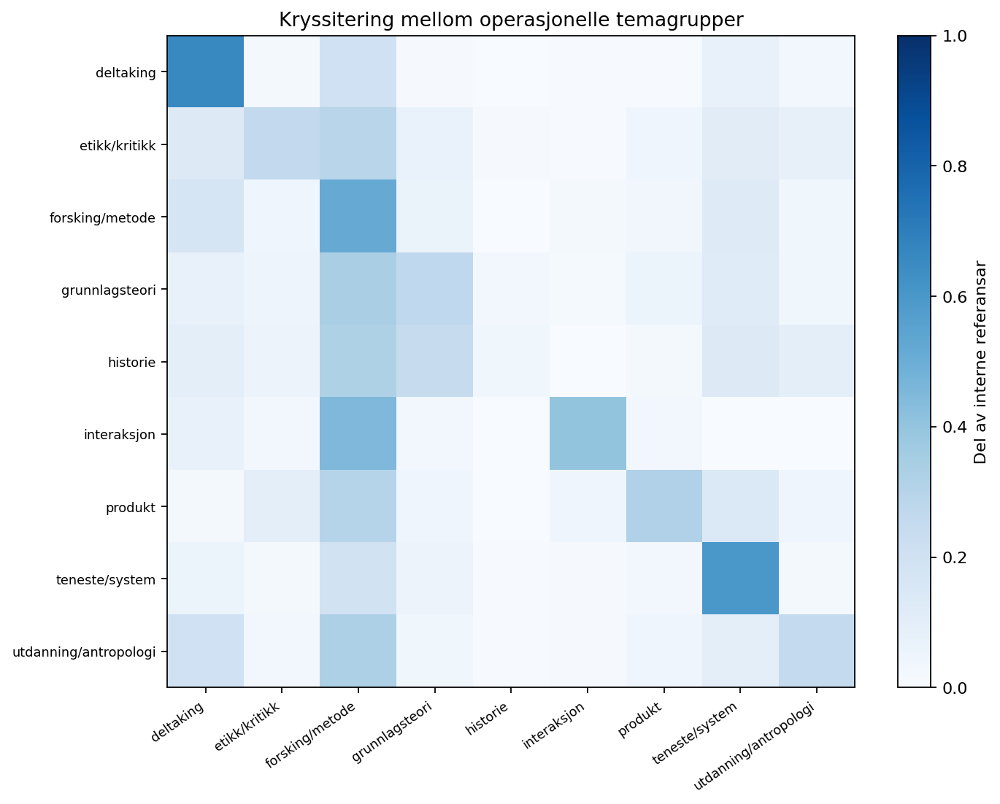

Observasjonen at 49,8 % av dei 3 159 interne siteringane koplar same operative
temagruppe, mot ein stratifisert nullmedian på om lag 21,1 %, viser struktur i
det innhenta siteringsnettverket. I eit førehandsavgrensa delutval på 382
publikasjonar frå utvalde designtidsskrift er talet 43,4 % mot 18,8 %.

Dette **må ikkje** forvekslast med kumulativitet: ei sitering kan vere ein
kontrast, ein laus omtale, ein kritikk, eit metodisk lån eller ein replikeringsstudie.
31,0 % av dei observerte interne kantane er mellom arbeid som deler minst éin
forfattar. Robustheitssjekkane testar også sitering utan slike kantar.

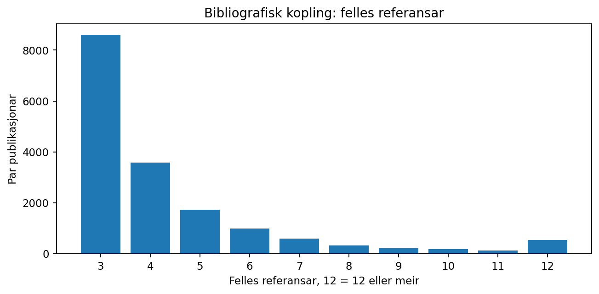

**Bibliografisk kopling** er eit anna mål: to publikasjonar som siterer dei same
tredje kjeldene. Den analysen nyttar også referansar som ikkje er i vårt
publikasjonsutval. Sterke koplingar er ikkje prøver av sanningsverdi.

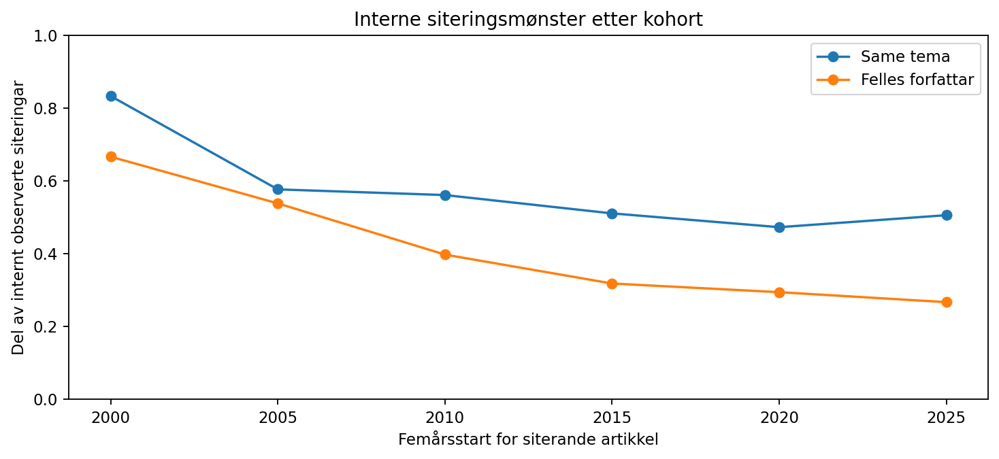

## 3. Tekstrom, klassifisering og stabilitet

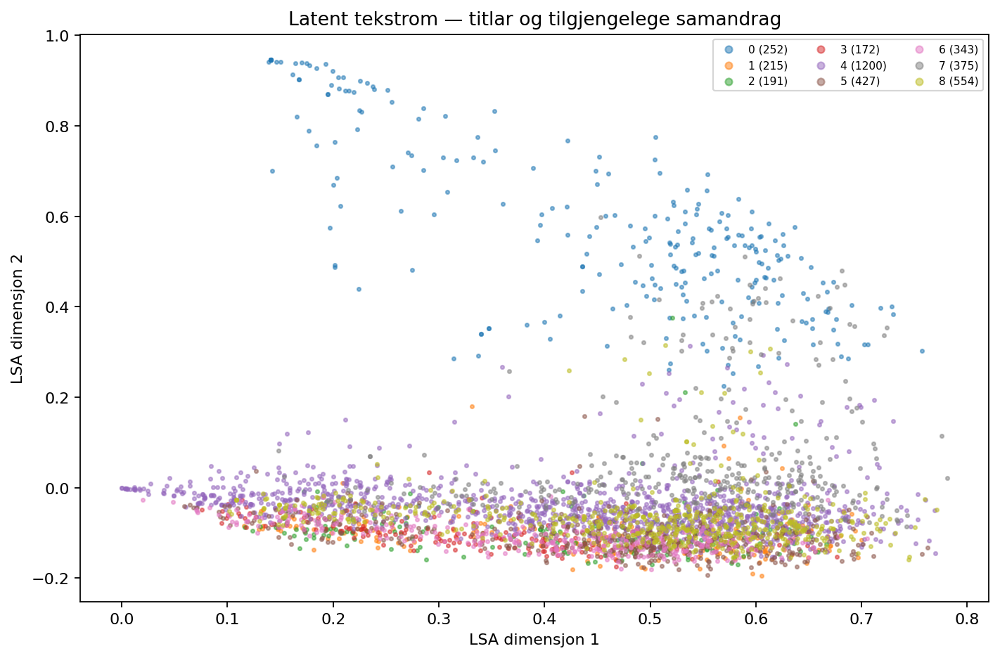

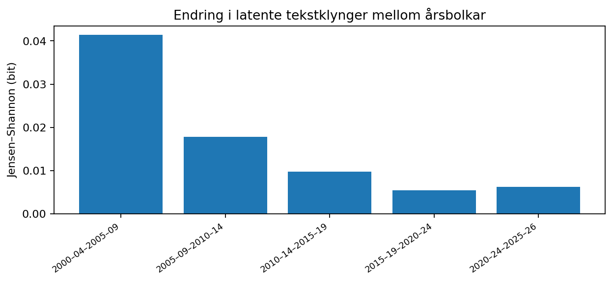

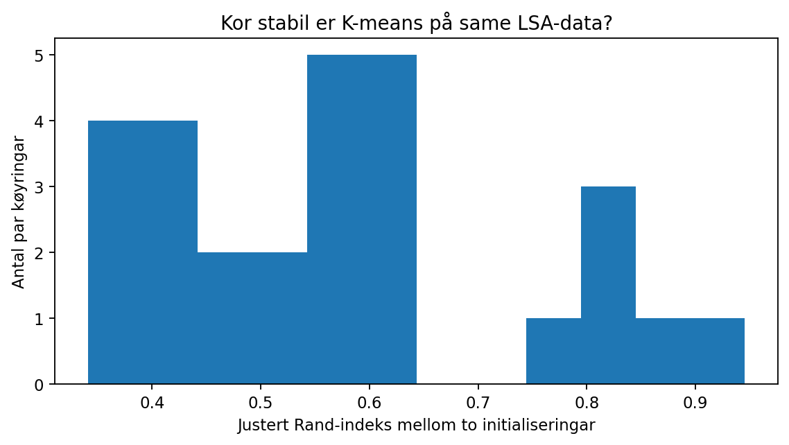

K-means har median justert Rand-indeks om lag 0,55 mellom åtte initialiseringar.
Det er **ikkje grunnlag** for å handsame desse ni klyngene som naturgjevne
eller stabile teoretiske skular.

## 4. Strengtreff for metodologisk språk

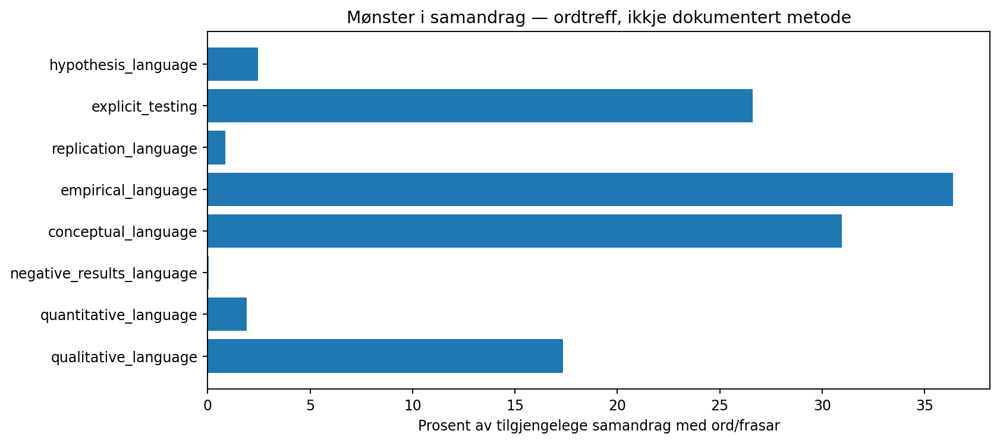

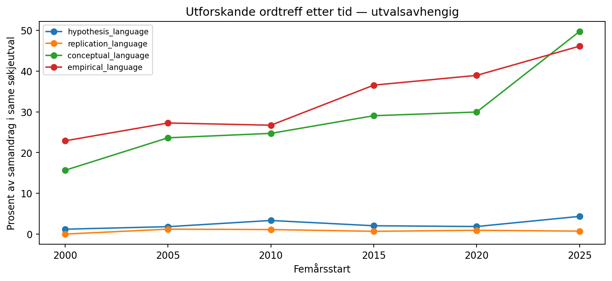

Av 2 922 tilgjengelege samandrag har 72 treff på valde hypoteseuttrykk
og 25 på replikasjons-/reproduksjonsuttrykk. Desse treffa er **ikkje ein
estimator for faktisk hypoteseprøving eller replikasjon**. Eit abstrakt kan
mangle slike ord sjølv om fullteksten demonstrerer metodane, og vise dei
sjølv om studien ikkje utfører dei. Språk og sjanger varierer.

## 5. Kontroll av utvals- og modellskjevleik

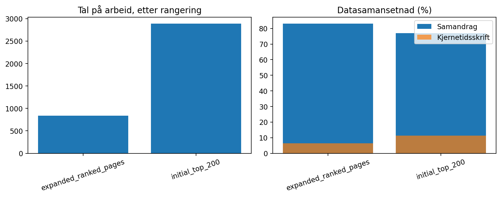

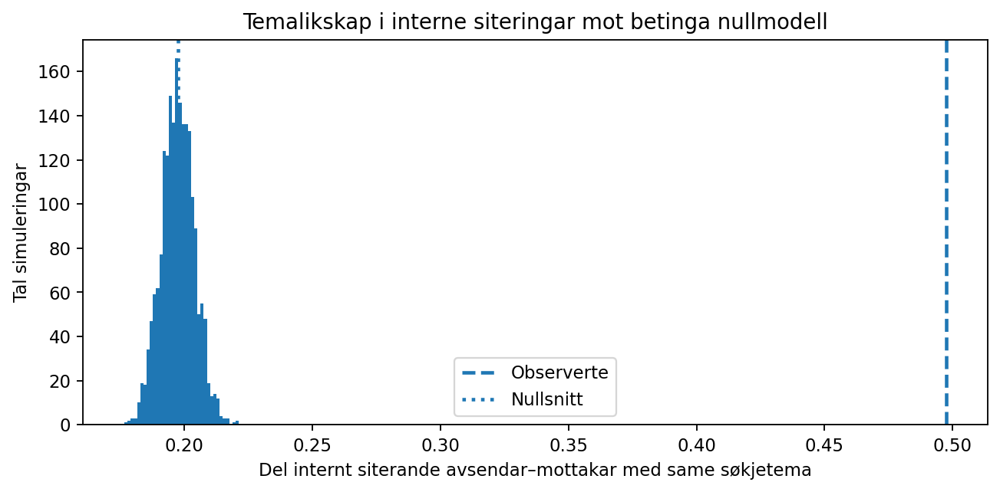

Søkerangeringa, kjernevenyutvalet, manglande samandrag og
kontroll av forfattaroverlapp kan endre resultata. Full metodisk oversikt:

- [Avansert analyse](AVANSERT_ANALYSE.md)
- [Datakvalitet](DATAKVALITET.md)
- [Språksignal](ABSTRAKT_SIGNAL.md)
- [Hovudrapport](RAPPORT.md)
- [Nullmodell og siteringskopling](robustness.json)
- [Kodebok for etterprøving](../CODEBOOK.md)

**Vitskapleg konklusjon:** Strukturen i forskingslitteraturen kan målast,
men påstanden om at designteori er ikkje-kumulativ er enno **ikkje testa
med eit tilstrekkeleg validert mål**. Neste steg er eksplisitt, blind
fulltekstkoding av prøvbare påstandar, korleis dei vert testet i seinare
arbeid og eventuelle negative resultat. Ei streng hypotese må kunne
verte tilbakevist.
