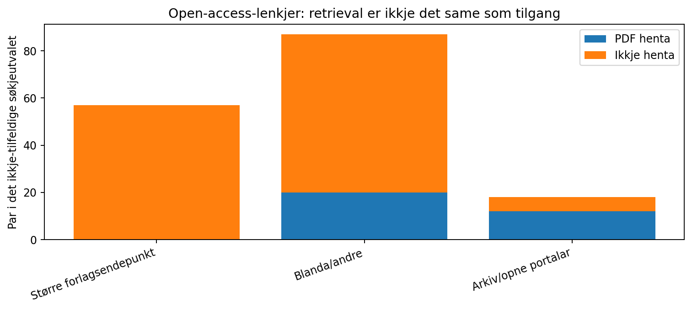

# PDF-tilgang og tekstfunn — kontroll av OpenAlex-arbeidslista

Generert 2026-11-02T18:29:42.323118+00:00. Dette er eit **målretta utval**, ikkje tilfeldig utval av alle nordiske forskingsartiklar.

- 162 siteringspar undersøkte.
- 32 par hadde ei lesbar PDF på den registrerte HTTPS-lenkja.
- 26 unike siterande PDF-dokument vart henta; nokre dokument opptrer i fleire par.
- 130 par gav tilkomstfeil, HTML, for store filer eller andre avvik.

## Tilkomsttilstand

| Tilstand | Par |
|---|---:|
| HTTP 403 | 92 |
| HTML / non-PDF | 33 |
| readable PDF | 32 |
| other | 3 |
| over 14 MB | 1 |
| blocked redirect | 1 |

## Finne ei konkret referanse

Automatisk andrepass fann 13 par med både bibliografisk og in-text *kandidat*,
17 med berre bibliografisk kandidat og
2 utan kandidat.

Verken namn–år-nærleik eller registrert DOI/tittel kan åleine vise **korleis ein
sitering vert brukt**. Dette krev kontroll av referansen, sjølve avsnittet og
originalarbeidet sitt argument. Bibliografisk tittel kan nemnast andre stader
enn i referanselista. Ein kontekst kan vere kritikk, lån, metode, test eller
replikasjon, og meir enn éin kategori kan vere relevant.

## Viktige feilkjelder

- OpenAlex sitt OA-felt peikar ofte på ein forlagslandingsside eller direkte lenkje
  som gjev HTTP 403; ikkje omdefiner dette til betalt, lukka eller uvitskapleg.
- Filsstorleik er avgrensa til 14 MB per dokument for kontrollen.
- Ulike årsfelt er ikkje harmoniserte før indeksering; sjå AARSKJELDEKRITIKK.md.
- Eitt etternamn kan peike til fleire studiar; forfattaren sin oppførte årgang
  kan vise til online-first versus tidsskriftvolum. Bruk DOI/tittel som eksterne
  kontrollar, og dokumenter kva som står i referanselista.
- Automatiske treff er ikkje brukt som kodingsfasit for C2–C5 eller L4–L7.

## Data og personvern
Dei 26 unike nedlasta fulltekstdokumenta er lokale, under data/oa_fulltexts_private/
på CYGNUS, og vert ikkje pusha til GitHub. Offentlege filer inneheld berre DOI,
OA-lenkjer, hash-verdiar, kontrollstatus og PDF-sidetilvisingar.

Analyser: oa_citation_locator_audit.csv, oa_reference_crosscheck.csv,
oa_retrievability_quality.json. Ver obs på at PDF-hash identifiserer eit
lokalt nedlasta dokument, ikkje nødvendigvis kanonisk utgåve.
