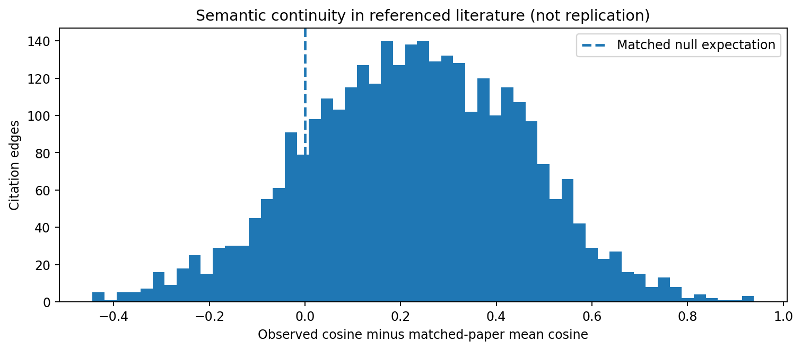
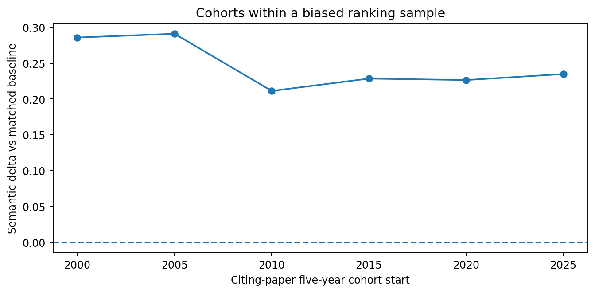

# Semantiske koplingar langs observerte siteringar

Generert 2026-11-02T17:22:10.615134+00:00.

Prosjektet måler kontinuitet i tekstsemantikk, ikkje om ei hypotese er testa,
stadfesta, falsifisert eller vidareutvikla. Resultat kan ha metadata- og utvalsskeivskap.

| Delutval | Siteringskantar | Gjennomsnittleg cosine-differanse | 95 % bootstrap (siterande artiklar) |
|---|---:|---:|---|
| all_observed_edges | 3159 | +0.228 | [+0.219, +0.239] |
| exclude_shared_author | 2180 | +0.199 | [+0.188, +0.210] |
| exclude_shared_author_both_abstracts_nonnegative_year | 1475 | +0.219 | [+0.207, +0.230] |
| same_theme_only | 1056 | +0.234 | [+0.219, +0.248] |
| cross_theme_only | 1124 | +0.167 | [+0.154, +0.181] |
| ten_or_more_year_gap | 482 | +0.201 | [+0.183, +0.220] |

## Avgrensingar
- Begge semantiske tekstrepresentasjonar kan mangle samandrag.
- Siteringslenkjer til arbeid utanfor det innhenta utvalet er ikkje med i paranalysen.
- Matchestrata vert utvida når det er få samanlikningskandidatar; fordelinga er rapportert i JSON.
- Felles forfattar kan vere teikn på eit utviklingsprogram, ikkje uavhengig replikasjon.
- Nullmodellen er ein intern samanlikning, ikkje ein publisert epistemisk referansestandard.

## Fulltekstutval til reell prøving
200 siteringspar med høg tekstlikskap er lagt i ein kandidat-CSV. Alle tolkingsfelt er blanke; menneskeleg fulltekstgransking er enno ikkje utført.

