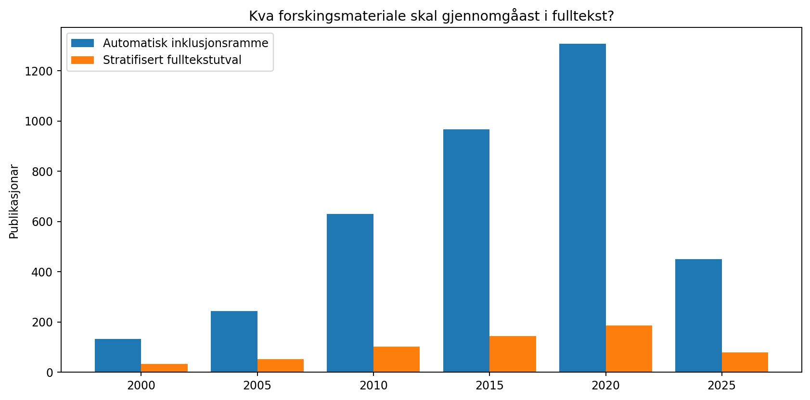

# Sannsynsutval og fulltekstprotokoll for kumulativitet

Dette er ein tilfeldig, stratifisert **600-postars prøve av den automatisk inkluderte databaseramma**.
Det er ikkje eit sannsynsutval av all nordisk designforsking og kan difor ikkje utan
ytterlegare registrering og kontroll generaliserast til heile faget.

Trekkseed 20261102; 54 ikkje-tomme strata etter søkjetema og femårsbolk.
Minimum tre testar per stratum når mogleg; resten fordelt etter rammevolum.
Sannsynet for å verte trekt og inverse utvalsvekter er lagra per post.
Søkjekategoriane er automatiske hjelpestrata og må ikkje forvekslast med valide fagdisiplinar.

## Koding
To uavhengige kodarar skal bruke CODEBOOK.md, og skal ikkje sjå kvarandre sine
vurderingar før kodinga er avslutta. Alle C/H/E-felt er medvite blanke.
Uleselege eller utilgjengelege fulltekstar skal kodast som manglande, ikkje 0.
Slutning om replikasjon krev spesifikke metodar og konkrete dokumenterte
sidetilvisingar. Cohen kappa og inter-rater-reliabilitet skal rapporterast
for kvar indikator før eventuelle generaliseringar.

## Presisjon
Eit tenkt enkelt tilfeldig utval n=600 ville ved 50 % og 95 %
ha normaltilnærma feilmargin om lag +/-4.0 prosentpoeng.
Den faktiske stratifiseringa, ulik vekting, ikkje-svar og skjermingsfeil
gjev andre usikkerheiter. Berekn ikkje dette som den faktiske studien si feilmargin.

Sjå: probability_sample_600_double_coder.csv, probability_sample_allocation.csv,
probability_sample_summary.json og CODEBOOK.md i overordna mappe.

Ingen fulltekstar er koda. Det er ikkje laga fabrikkerte funn.
